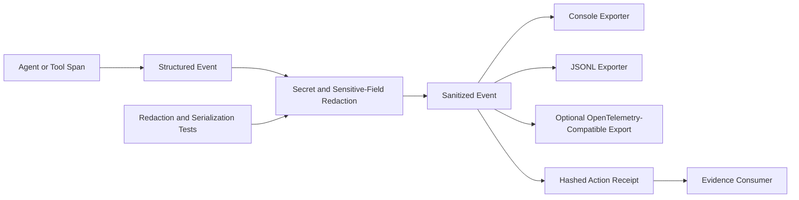
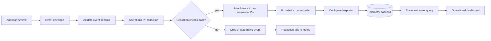

# x4-agent-observability

[](https://github.com/dhe-cruzer69/x4-agent-observability/actions)
[](LICENSE)

**Local-first agent telemetry with evidence receipts.**

Vendor-neutral event model. Console and JSONL exporters first; OpenTelemetry-compatible when enabled.

## Quick start

```bash
pip install -e ".[dev]"
python -c "from x4_obs import trace; 
with trace.agent('demo'):
    with trace.tool('ping'):
        pass"
```

<!-- X4-APEX-DIAGRAM-START:x4-agent-observability -->



<!-- X4-APEX-DIAGRAM-END:x4-agent-observability -->

## Receipts

Every sensitive action can emit a hashed receipt (before/after, actor, approval).

## License

Apache-2.0

## APEX Architecture Map

> Status: architecture documentation; implementation and deployment claims require independent verification.



**Evidence note:** Redaction guarantees, exporter retries, buffer limits, and backend integrations need implementation-level verification. Never send raw secrets to telemetry.

